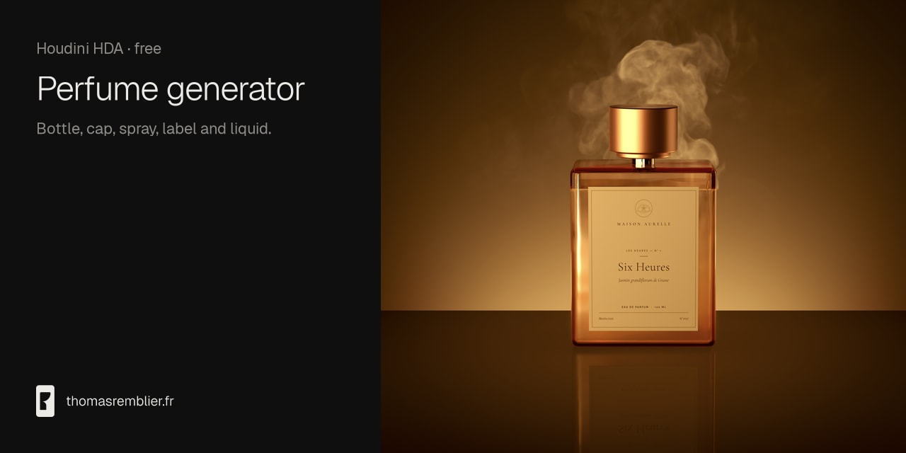

# Perfume generator

A Houdini SOP asset that generates a perfume bottle procedurally. Bottle, cap, spray, label and liquid each have their own parameter tab.

Project page: https://thomasremblier.fr/fr/projet/perfume-generator/

## Install

1. Download the `.otllc` file from the latest release.
2. In Houdini, open Assets, then Install Asset Library, and select the file.
3. In a Geometry network, press Tab and create a Perfume generator node.

## Compatibility

- Houdini: 21.0.700, the version the asset was exported from.
- Node context: SOP.
- Asset version: 2.0.
- Preview: rendered with Karma, graded in DaVinci Resolve.

## Inputs and outputs

- Inputs: none. The node takes no input (minimum 0, maximum 0).
- Outputs: no output label is defined in the asset.

## Parameters

The asset has eight tabs: Flacon (the bottle), Flacon › Profile Control, Flacon › Frost, Cap, Cap › Profile Control, Spray, Label and Liquid.

Labels are the ones shown in the interface, and rows follow the order of the asset. The asset defines no help text, so Description lists menu options only. Defaults and ranges come from the asset.

## License

Free to download. The license terms are in the `LICENSE` file at the root of the repository.

The bottle in the preview is Six Heures, a perfume by Maison Aurelle, a fictional brand.

Need a custom tool or a studio license? contact@thomasremblier.fr
